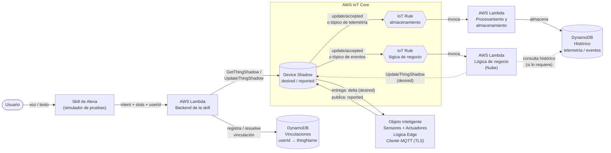

# Práctica 4 — Procesamiento, Almacenamiento y Lógica de Negocio de Objetos Inteligentes con AWS y Alexa

**Carrera:** Ingeniería de Sistemas
**Asignatura:** SIS-234
**Modalidad:** grupos de 2 o 3 integrantes
**Fecha límite de entrega:** martes 24 de noviembre de 2026, 17:45

---

## 1. Nombre de la Actividad Evaluativa

**Integración de un objeto inteligente con AWS (IoT Core, IoT Rules, Lambda y DynamoDB) y Alexa, con procesamiento, almacenamiento de datos y lógica de control en el Edge y/o en la Nube.**

---

## 2. Propósito de la Actividad Evaluativa

Evaluar el desarrollo de los siguientes saberes:

### 2.1 Saber Conceptual
- Librerías y plataformas en la nube para el IoT: AWS IoT Core (Device Shadow y reglas de AWS IoT), funciones AWS Lambda y Amazon DynamoDB.
- Procesamiento en el Edge y en la Nube: criterios para decidir dónde se ejecuta la lógica de negocio.
- Herramientas de IA: Amazon Alexa (skills, intents y slots).

### 2.2 Saber Procedimental
- Implementa protocolos de aplicación con integración en la nube: MQTT sobre TLS.
- Implementa sistemas integrados con plataformas en la nube: AWS IoT Core, AWS IoT Rules, AWS Lambda, Amazon DynamoDB y Alexa.
- Diseña modelos de datos NoSQL a partir de los patrones de acceso de la aplicación.

### 2.3 Saber Actitudinal (Saber Ser)
- Disposición a realizar prácticas y ejercicios en equipo.
- Responsabilidad en sus asignaciones y prácticas.
- Orden, sistematicidad y disciplina durante el análisis, diseño y construcción del prototipo.

---

## 3. Descripción de la Actividad

La Práctica 4 es una **extensión de la Práctica 3**. Cada grupo parte del objeto inteligente, el *Thing*, el Device Shadow, la skill de Alexa, la función Lambda de la skill y el mecanismo de vinculación usuario ↔ *Thing* que desarrolló en la Práctica 3, y los amplía para construir un **sistema distribuido** compuesto por:

- **Uno o varios Objetos Inteligentes** con un MCU con conectividad WiFi, con los **sensores y actuadores que el caso de uso requiera**, registrados como *Things* en **AWS IoT Core** y sincronizados mediante su **Device Shadow**. La cantidad y el tipo de sensores y actuadores deben **justificarse** según la aplicación que se desea implementar.
- **1 skill de Alexa (frontend)**, utilizada a través del **simulador de pruebas** de la Alexa Developer Console.
- **1 función AWS Lambda (backend de la skill)**, que consulta y modifica el Shadow del objeto inteligente vinculado a cada usuario (heredada de la Práctica 3 y ampliada).
- **Una o varias reglas de AWS IoT (*IoT Rules*) + una o varias funciones AWS Lambda** que **procesan y almacenan** los datos del objeto inteligente en **Amazon DynamoDB** y que ejecutan la **lógica de negocio en la Nube**, si el caso de uso lo requiere. El almacenamiento del histórico y la lógica de negocio son **responsabilidades distintas**: no tienen por qué resolverse en la misma función Lambda ni dispararse con la misma regla (ver §3.1).
- **Tablas en Amazon DynamoDB** para las vinculaciones usuario ↔ *Thing* (Práctica 3) y para el **histórico de datos** del objeto inteligente (lecturas de sensores y eventos de los actuadores).

La skill sigue sin estar atada a un único *Thing*: debe atender a distintos usuarios de Alexa, cada uno con su propio objeto inteligente, y los datos almacenados deben poder distinguirse por *Thing*.

Si el grupo decide **ampliar o modificar el caso de uso** de la Práctica 3 (p. ej. agregar sensores o actuadores), debe justificar el cambio en el informe. El prototipo debe seguir concibiéndose de modo que, a futuro, pueda extenderse con más sensores y actuadores sin rediseñar su arquitectura.

**Restricciones sobre los componentes:**

- Se permite utilizar **LEDs como actuadores**, pero **no como únicos actuadores**: el objeto inteligente debe contar con al menos un actuador que no sea un LED (p. ej. motor, bomba, servomotor, ventilador, cerradura solenoide o buzzer).
- El **sensor ultrasónico** solo puede utilizarse si el caso de uso lo requiere (p. ej. medición del nivel de un tanque), y su uso debe justificarse en el informe.
- Por seguridad, los actuadores deben operar a **baja tensión (≤ 12 V DC)**; no se permite conmutar cargas de 220 V AC.



> Alexa y la lógica de la Nube nunca se comunican directamente con el objeto inteligente: toda interacción pasa por el Shadow en AWS IoT Core. El diagrama es referencial —muestra una regla y una función por responsabilidad, pero puede haber más—: cada grupo debe elaborar su propio diagrama de arquitectura y de secuencia (§4.2).

### 3.1 Lógica de Control: Edge, Nube o ambos

A diferencia de la Práctica 3 —en la que el actuador se controlaba únicamente por voz—, en esta práctica el sistema debe incorporar la **lógica de control y de negocio que el caso de uso requiera**. Según la aplicación, esa lógica puede ejecutarse:

- **En el Edge** (en el objeto inteligente): adecuado cuando se requiere respuesta inmediata, cuando el sistema debe seguir operando sin conexión a Internet o cuando la decisión depende solo de los datos locales (p. ej. control por umbral con histéresis).
- **En la Nube** (IoT Rule + Lambda): adecuado cuando la decisión depende del histórico, de varios objetos, de datos externos o de reglas que conviene cambiar sin reprogramar el objeto (p. ej. límite diario de funcionamiento de un actuador, detección de un sensor que dejó de reportar). La Lambda actúa sobre el objeto **modificando la sección `desired` de su Shadow**.
- **En ambos**, repartiendo responsabilidades entre el Edge y la Nube.

La lógica de negocio en la Nube **no tiene por qué ejecutarse en la misma función Lambda que almacena el histórico**. Según el caso de uso, puede requerirse **varias reglas de AWS IoT y varias funciones Lambda**, cada una con una responsabilidad acotada; por ejemplo:

- una regla sobre los reportes del Shadow que invoca una Lambda que **valida y almacena** las lecturas en DynamoDB;
- otra regla, con una sentencia SQL que filtra solo los mensajes relevantes (p. ej. cambios de estado de un actuador o lecturas fuera de rango), que invoca una Lambda de **lógica de negocio** que decide y actualiza el `desired` del Shadow;
- una Lambda de lógica de negocio que se ejecuta de forma **programada** (p. ej. con Amazon EventBridge) para revisar el histórico, sin depender de un mensaje del objeto.

La separación en reglas y funciones debe justificarse en el informe (responsabilidad única, frecuencia de invocación, permisos necesarios de cada función y costo).

La **ubicación de cada regla de control debe justificarse** en el informe (latencia, operación sin conexión, necesidad de datos históricos, costo de mensajes, facilidad de mantenimiento). Además, el grupo debe definir y documentar cómo conviven los **comandos de voz** con la **lógica automática** (p. ej. modos `manual` / `automatico`, prioridad de un comando de voz sobre la regla automática, o rechazo del comando con una respuesta explicativa) para evitar conflictos sobre un mismo actuador.

### 3.2 Requerimientos Funcionales Mínimos

**Se mantienen los requerimientos RF1 a RF9 de la Práctica 3** (captura y reporte de sensores, aplicación del `delta`, consultas y comandos por voz, y vinculación usuario ↔ *Thing*), aplicados a todos los sensores y actuadores del objeto. Adicionalmente, el sistema deberá cumplir, como mínimo, con los siguientes requerimientos:

**Procesamiento y almacenamiento (IoT Rules + Lambda + DynamoDB)**

- **RF10.** Disparar una o varias **reglas de AWS IoT** a partir de los datos que publica el objeto inteligente (p. ej. sobre el tópico `$aws/things/+/shadow/update/accepted` o sobre un tópico de telemetría propio), que invoquen las **funciones Lambda** de procesamiento y almacenamiento.
- **RF11.** Procesar en la Lambda de almacenamiento los datos recibidos (validación de rangos y tipos, descarte de mensajes inválidos, y enriquecimiento con al menos el `thingName` y la marca de tiempo) y **almacenar las lecturas de los sensores** en una tabla de DynamoDB.
- **RF12.** Registrar en DynamoDB los **eventos de los actuadores** (cambio de estado), incluyendo el **origen** del cambio (p. ej. `voz`, `edge`, `nube`).

**Lógica de control y de negocio**

- **RF13.** Implementar la lógica de control automática que el caso de uso requiera, en el Edge, en la Nube o en ambos, con la ubicación de cada regla justificada (§3.1). La lógica en la Nube, si existe, se implementa en las funciones Lambda que el diseño requiera —separadas o no de las de almacenamiento, con la decisión justificada— y debe actuar sobre el objeto únicamente a través de la sección `desired` del Shadow.
- **RF14.** Reportar en la sección `reported` del Shadow el **modo de operación** y los **parámetros** de la lógica automática (p. ej. umbrales), y permitir **consultarlos y modificarlos por voz** desde Alexa, a través de la sección `desired`.

**Diseño de reportes**

- **RF15.** Diseñar (**mockups**, no se exige su implementación) los reportes con información relevante para la **toma de decisiones** del usuario del caso de uso, construidos a partir de los datos almacenados en DynamoDB. El modelo de datos de DynamoDB debe permitir obtener la información que muestran los mockups (ver §4.2).

Cada grupo deberá **definir y documentar su caso de uso ampliado, la estructura actualizada de su documento Shadow, las reglas de AWS IoT, el modelo de datos de DynamoDB, la lógica de control y el modelo de interacción actualizado de su skill** en el informe. Los ejemplos siguientes son únicamente **ilustrativos** y continúan el caso de riego de la Práctica 3.

**Ejemplo — lógica de control (caso de riego):**

| Regla | Ubicación | Justificación |
|-------|-----------|---------------|
| En modo `automatico`, encender la bomba si `humedad_suelo < umbral_min` y apagarla al superar `umbral_max` (histéresis). | Edge | Respuesta inmediata y operación aunque se pierda la conexión. |
| Si la bomba acumula más de 30 min encendida en el día, apagarla y pasar a modo `manual`. | Nube | Requiere el histórico de eventos almacenado en DynamoDB. |
| Si el *Thing* no reporta durante 15 min, registrar una alerta de sensor sin datos. | Nube | El objeto, por definición, no puede reportar su propia desconexión. |

**Ejemplo — documento Shadow ampliado (caso de riego):**

```json
{
  "state": {
    "desired":  { "modo": "automatico", "umbral_min": 30, "umbral_max": 60 },
    "reported": {
      "humedad_suelo": 37.5,
      "bomba": "off",
      "modo": "automatico",
      "umbral_min": 30,
      "umbral_max": 60
    }
  }
}
```

**Ejemplo — reglas de AWS IoT (SQL):**

Regla de almacenamiento → Lambda que valida y guarda las lecturas en la tabla de histórico:

```sql
SELECT state.reported AS reported, topic(3) AS thingName, timestamp() AS ts
FROM '$aws/things/+/shadow/update/accepted'
WHERE NOT isUndefined(state.reported)
```

Regla de lógica de negocio → Lambda que controla el tiempo diario de riego, invocada solo cuando cambia el estado de la bomba:

```sql
SELECT state.reported.bomba AS bomba, topic(3) AS thingName, timestamp() AS ts
FROM '$aws/things/+/shadow/update/accepted'
WHERE NOT isUndefined(state.reported.bomba)
```

La regla *"Si el Thing no reporta durante 15 min"* no puede dispararse con un mensaje del objeto: se implementaría con otra Lambda ejecutada de forma programada.

**Ejemplo — tabla de histórico en DynamoDB:**

| `thingName` (clave de partición) | `ts` (clave de ordenamiento) | `tipo` | `humedad_suelo` | `bomba` | `origen` |
|----------------------------------|------------------------------|--------|-----------------|---------|----------|
| `maceta-grupo3-01` | `2026-11-20T10:15:00Z` | `lectura` | 37.5 | `off` | — |
| `maceta-grupo3-01` | `2026-11-20T10:17:42Z` | `evento` | 28.9 | `on` | `edge` |
| `maceta-grupo3-01` | `2026-11-20T10:21:05Z` | `evento` | 61.2 | `off` | `edge` |

> El diseño de la tabla (una o varias tablas, claves, índices secundarios, TTL) debe partir de los **patrones de acceso** que requieren los reportes diseñados y la lógica de la Nube (p. ej. *"lecturas de un Thing en un rango de fechas"*, *"eventos de la bomba de hoy"*), y no solo de la forma de los mensajes.

**Ejemplos adicionales de instrucciones en lenguaje natural** que la skill debe poder atender (caso de riego), además de las de la Práctica 3:

- _"Activa el modo automático."_
- _"¿En qué modo está el riego?"_
- _"Cambia la humedad mínima a treinta y cinco por ciento."_
- _"¿Cuáles son los umbrales de riego?"_

> Nota: el caso de uso, los nombres de los atributos del Shadow, la estructura de las tablas, las reglas y las frases de los ejemplos no son obligatorios; lo obligatorio son RF1 a RF15 y las restricciones sobre los componentes.

### 3.3 Requerimientos No Funcionales

**Se mantienen los requerimientos no funcionales de la Práctica 3** (estabilidad, exactitud de medición, tiempo de respuesta, frecuencia de reporte, y reconexión y sincronización), aplicados a todos los sensores y actuadores del objeto. Adicionalmente, cada grupo deberá declarar y **verificar en la sección de Pruebas y Validaciones** al menos los siguientes atributos, con valores medibles:

- **Integridad del almacenamiento:** porcentaje de mensajes publicados por el objeto que quedan almacenados en DynamoDB durante una ventana de prueba declarada (referencia: ≥ 99 %), y descarte correcto de los mensajes inválidos.
- **Latencia de almacenamiento:** tiempo máximo declarado desde que el objeto publica un dato hasta que queda registrado en DynamoDB (referencia: ≤ 5 s).
- **Tiempo de respuesta de la lógica automática:** tiempo máximo declarado desde que se cumple la condición de una regla hasta que el actuador cambia de estado, medido por separado para las reglas del Edge y de la Nube, y coherente con la dinámica del caso de uso.
- **Operación sin conexión:** comportamiento declarado del objeto cuando pierde la conexión (qué reglas del Edge siguen operando y qué ocurre con los datos no enviados), verificado en las pruebas.
- **Costo:** estimación del consumo mensual de mensajes de AWS IoT Core, invocaciones de Lambda y escrituras/lecturas de DynamoDB según la frecuencia de reporte declarada, comparada con los límites de la capa gratuita.

El código debe ser **legible, modular (orientado a objetos en el objeto inteligente; funcional/serverless y organizado por responsabilidades en las funciones Lambda), documentado y conforme a las convenciones de codificación del lenguaje utilizado**.

**Seguridad** (se mantienen las condiciones de la Práctica 3, ampliadas a los nuevos recursos):

- Los **certificados y la clave privada** del *Thing*, así como las credenciales WiFi, **no deben publicarse** en el repositorio: se mantienen en archivos excluidos mediante `.gitignore`, acompañados de una plantilla de ejemplo sin valores reales.
- Se **recomienda** aplicar el principio de **mínimo privilegio** a la política de AWS IoT del objeto, a los roles IAM de cada función Lambda y a los roles de las reglas de AWS IoT. Separar el almacenamiento de la lógica de negocio facilita este principio: por ejemplo, la Lambda de almacenamiento solo requiere `dynamodb:PutItem` sobre la tabla de histórico; la Lambda de lógica de negocio, `iot:UpdateThingShadow` sobre los *Things* y `dynamodb:Query` si consulta el histórico; y cada regla de AWS IoT solo requiere permiso para invocar su Lambda (`lambda:InvokeFunction`).
- Para **simplificar la configuración**, se acepta asignar permisos más amplios (políticas administradas por AWS o comodines `*` en recursos), siempre que el informe **documente qué permisos se asignaron, por qué, y qué permisos mínimos serían necesarios** en un entorno de producción.
- En ningún caso se deben incluir **claves de acceso de AWS** (*access keys*) en el código del objeto inteligente ni de las funciones Lambda.

> Se recomienda utilizar la capa gratuita de AWS, configurar una **alerta de facturación** en la cuenta y, para la tabla de histórico, evaluar el uso de **TTL** para limitar el volumen de datos almacenados.

---

## 4. Entregables

### 4.1 Prototipo Funcional
Se deberá presentar un prototipo completamente operativo que demuestre la integración entre el objeto inteligente, AWS IoT Core (Shadow y reglas), las funciones Lambda, las tablas de DynamoDB (vinculaciones e histórico), la lógica de control y la skill de Alexa.

### 4.2 Informe Técnico

El informe se entrega en **formato Markdown**, dentro del repositorio de la práctica (ver sección 6), y debe contener las siguientes secciones mínimas:

1. **Caso de Uso y Requerimientos**
   - Descripción del caso de uso (y de su ampliación respecto a la Práctica 3) y justificación de la cantidad y tipo de sensores y actuadores elegidos
   - Requerimientos funcionales y no funcionales
2. **Análisis y Diseño**
   - Diagrama de bloques del objeto inteligente
   - Diagrama de arquitectura del sistema (bloques o despliegue), incluidas las reglas de AWS IoT, las funciones Lambda y las tablas de DynamoDB
   - Diagrama de circuito del objeto inteligente
   - Diagrama de clases (estructural) del objeto inteligente y de las funciones Lambda
   - Diagramas de secuencia (comportamiento), que incluyan al menos: una consulta del sensor y un comando sobre el actuador desde el usuario hasta el objeto inteligente, el flujo de almacenamiento de un dato (objeto → IoT Rule → Lambda → DynamoDB) y la ejecución de cada regla automática (Edge y/o Nube)
   - Diagrama de estados o de actividades de la lógica de control (modos de operación y transiciones), con la justificación de la ubicación de cada regla (Edge / Nube)
   - Especificación del documento Shadow actualizado (atributos, tipos, valores válidos y uso de `desired`, `reported` y `delta`)
   - Diseño del modelo de datos de DynamoDB: tablas, atributos y tipos de datos, claves de partición y de ordenamiento, índices secundarios y TTL si corresponden, y los patrones de acceso que satisface
   - Diseño de las reglas de AWS IoT y de las funciones Lambda de la Nube: para cada regla, su sentencia SQL, tópicos y acción; para cada función, su responsabilidad (almacenamiento, lógica de negocio, backend de la skill), su disparador (regla, Alexa o programación) y los recursos a los que accede
   - Diseño de la skill de Alexa actualizado (nombre de invocación, intents, slots y frases de ejemplo)
   - Diseño de reportes (**mockups**) con información relevante para la toma de decisiones, indicando de qué datos y consultas de DynamoDB se obtiene cada elemento
3. **Desarrollo e Implementación**
   - Descripción de la estructura del código (módulos y clases principales) y explicación de los fragmentos clave, con enlaces al código fuente del repositorio (no se copia el código completo en el informe)
   - Configuraciones en AWS: *Thing*, certificados, política de AWS IoT, reglas de AWS IoT, funciones Lambda, tablas de DynamoDB y roles IAM (sin exponer secretos), con la justificación de los permisos asignados (§3.3)
   - Configuraciones en Alexa: modelo de interacción y vinculación con la función Lambda
4. **Pruebas y Validaciones**
5. **Resultados**
6. **Conclusiones**
7. **Recomendaciones**
8. **Anexos**

---

## 5. Evaluación

### 5.1 Ponderación

| Componente | Peso |
|-------------|-------------|
| Informe Técnico | 1/3 |
| Demo | 1/3 |
| Defensa Individual | 1/3 |

- El **Informe Técnico** se califica con una rúbrica de **4 criterios de 0 a 4 puntos** (16 puntos máximo): nota del componente = `(puntos obtenidos / 16) × 100`.
- La **Demo** y la **Defensa Individual** se califican de forma **global, con un único nivel de 0 a 4**: nota del componente = `(nivel obtenido / 4) × 100`.

La nota final es el promedio de los tres componentes.

En los tres casos, el nivel **0 — No presentado** aplica cuando lo evaluado no se entrega, no se presenta o no puede evidenciarse.

---

### 5.2 Rúbrica del Informe Técnico (1/3)

#### 5.2.1 Criterios de Evaluación

| Criterio | Puntuación |
|------------|--------------|
| Requerimientos, análisis y diseño | 0 – 4 |
| Desarrollo e implementación (código y documentación) | 0 – 4 |
| Pruebas y validaciones | 0 – 4 |
| Resultados, conclusiones y recomendaciones | 0 – 4 |

> El funcionamiento del prototipo en vivo no se evalúa aquí, sino en la Demo (§5.3).

#### 5.2.2 Rúbrica Analítica

**Requerimientos, análisis y diseño**

| Nivel | Descripción |
|----------|---------------|
| **4 - Excelente** | Caso de uso real y bien justificado, incluida la cantidad y tipo de sensores y actuadores. Requerimientos funcionales y no funcionales completos, medibles y trazables al diseño. Incluye todos los diagramas exigidos en §4.2 (bloques, arquitectura, circuito, clases, secuencia y lógica de control), la especificación completa del documento Shadow, el diseño de las reglas de AWS IoT, un modelo de datos de DynamoDB coherente con los patrones de acceso, el diseño de la skill y mockups de reportes útiles para la toma de decisiones. La ubicación de la lógica (Edge / Nube) y la frecuencia de reporte están justificadas. Los diagramas permiten comprender totalmente el sistema y su secuencia de ejecución. |
| **3 - Satisfactorio** | Caso de uso y requerimientos definidos; diagramas, modelo de datos y mockups claros que explican el funcionamiento general del sistema. |
| **2 - Satisfactorio con recomendaciones** | Caso de uso poco justificado, requerimientos imprecisos, diagramas incompletos o con poca claridad, o modelo de datos que no permite obtener la información de los mockups. |
| **1 - Necesita mejorar** | Falta uno o más diagramas esenciales, el modelo de datos o los mockups, o los requerimientos no están definidos. |
| **0 - No presentado** | La sección no fue entregada. |

**Desarrollo e implementación (código y documentación)**

| Nivel | Descripción |
|----------|---------------|
| **4 - Excelente** | Código del objeto inteligente (modular, POO) y de las funciones Lambda (funcional/serverless, organizado por responsabilidades) bien estructurado, documentado y con buenas prácticas. Configuraciones de AWS (IoT Core, reglas, Lambda, DynamoDB, IAM) y Alexa documentadas, con los permisos asignados justificados y sin secretos expuestos. La implementación descrita cubre todos los requerimientos declarados. |
| **3 - Satisfactorio** | Código estructurado y coherente con los requerimientos, con documentación básica de código y configuraciones. |
| **2 - Satisfactorio con recomendaciones** | Código con mala organización o sin convenciones claras, o configuraciones documentadas de forma incompleta. |
| **1 - Necesita mejorar** | Código incompleto, sin documentación, que no corresponde a los requerimientos declarados o que expone credenciales. |
| **0 - No presentado** | No se entregó código fuente. |

**Pruebas y validaciones**

| Nivel | Descripción |
|----------|---------------|
| **4 - Excelente** | Plan de pruebas completo que verifica los requerimientos funcionales (incluidas las frases de la skill, el almacenamiento en DynamoDB y cada regla de la lógica de control) y los valores declarados en los no funcionales, con documentación detallada y análisis de errores si corresponde. |
| **3 - Satisfactorio** | Plan de pruebas adecuado con documentación básica. |
| **2 - Satisfactorio con recomendaciones** | Plan incompleto con validaciones parciales. |
| **1 - Necesita mejorar** | Pruebas insuficientes. |
| **0 - No presentado** | No se documentaron pruebas. |

**Resultados, conclusiones y recomendaciones**

| Nivel | Descripción |
|----------|---------------|
| **4 - Excelente** | Resultados cuantificables (incluidos los obtenidos de los datos almacenados en DynamoDB), análisis crítico —p. ej. de la decisión Edge / Nube—, conclusiones fundamentadas y recomendaciones técnicas, incluidas posibles extensiones del objeto hacia un uso real. Anexos pertinentes. |
| **3 - Satisfactorio** | Resultados medibles con conclusiones coherentes. |
| **2 - Satisfactorio con recomendaciones** | Resultados limitados, conclusiones básicas, sin recomendaciones. |
| **1 - Necesita mejorar** | Resultados poco claros o no medibles. |
| **0 - No presentado** | La sección no fue entregada. |

---

### 5.3 Rúbrica de la Demo (1/3)

La demostración se califica de forma global con un único nivel de 0 a 4.

| Nivel | Descripción |
|----------|---------------|
| **4 - Excelente** | El sistema opera de forma completa y estable, con toda la interacción pasando por el Shadow en AWS IoT Core: la skill atiende, sobre el *Thing* vinculado, las consultas y comandos de voz solicitados durante la demostración (incluidos el modo de operación y los parámetros de la lógica automática); la lógica de control se ejecuta en el Edge y/o en la Nube según lo diseñado, sin conflictos con los comandos de voz; los datos y eventos se almacenan correctamente en DynamoDB y pueden mostrarse durante la demostración; el actuador responde y el Shadow refleja el estado real del objeto. Se verifican los requerimientos no funcionales declarados, incluidas la reconexión con aplicación del estado `desired` pendiente y la operación sin conexión. Montaje ordenado y seguro. |
| **3 - Satisfactorio** | El sistema cumple todos los requerimientos funcionales, con fallas menores que no impiden la demostración. |
| **2 - Satisfactorio con recomendaciones** | El sistema funciona parcialmente: alguna consulta, comando, regla automática, almacenamiento en DynamoDB o sincronización con el Shadow no responde como fue especificado, o la skill solo funciona con un *Thing* fijo. |
| **1 - Necesita mejorar** | Prototipo no funcional o con fallas críticas durante la demostración. |
| **0 - No presentado** | No se presentó el prototipo. |

---

### 5.4 Rúbrica de la Defensa Individual (1/3)

La defensa se califica de forma global con un único nivel de 0 a 4.

| Nivel | Descripción |
|----------|---------------|
| **4 - Excelente** | Responde con precisión y profundidad, explica cualquier parte del código, del circuito, de la configuración de AWS (Shadow, reglas de AWS IoT, políticas y permisos, Lambda, DynamoDB), del modelo de datos, de la lógica de control (Edge / Nube), de los mockups de reportes y de la skill de Alexa, y justifica técnicamente las decisiones tomadas. Su aporte al grupo es claro y verificable en el historial de commits del repositorio. |
| **3 - Satisfactorio** | Responde correctamente sobre el conjunto del trabajo, con dudas en aspectos puntuales. |
| **2 - Satisfactorio con recomendaciones** | Conoce solo la parte en la que trabajó directamente; explicaciones superficiales. |
| **1 - Necesita mejorar** | No logra explicar el funcionamiento del sistema ni justificar las decisiones de diseño. |
| **0 - No presentado** | No se presentó a la defensa. |

---

## 6. Entrega Final

**Qué se entrega:** un repositorio GitHub que contenga:

- El **informe técnico** de la Práctica 4 en formato Markdown, con la estructura de §4.2.
- El **código fuente** documentado del objeto inteligente y de las funciones Lambda (backend de la skill, procesamiento y almacenamiento, y lógica de negocio).
- Las **configuraciones** exportadas: modelo de interacción de la skill (JSON), política de AWS IoT, definición de las reglas de AWS IoT (SQL y acciones), políticas de los roles IAM de las funciones Lambda y de las reglas, definición de las tablas de DynamoDB y plantilla de configuración del objeto inteligente (sin certificados ni credenciales).
- Los **mockups** de los reportes.
- Los **anexos** (diagramas, esquemas, fotografías y evidencias de las pruebas, incluidas muestras de los datos almacenados en DynamoDB).

Se puede continuar en el **mismo repositorio de la Práctica 3**, siempre que el informe de la Práctica 4 esté en un archivo propio y claramente identificado; el informe de la Práctica 3 no debe sobrescribirse.

Cada integrante debe realizar **commits con su propia cuenta de GitHub**; el historial de commits se utiliza como evidencia de su aporte en la Defensa Individual (§5.4).

**Cómo se entrega:** el **enlace del repositorio GitHub** se envía por el **LMS-UCB**.

**Cuándo:** hasta el **martes 24 de noviembre de 2026 a las 17:45**.

> El repositorio debe estar accesible para el docente en la fecha de entrega. Solo se evalúa el contenido existente en el repositorio hasta esa fecha; un enlace inaccesible equivale a trabajo no entregado. La entrega del enlace por el LMS es responsabilidad de cada grupo, y basta con que la realice un integrante.
