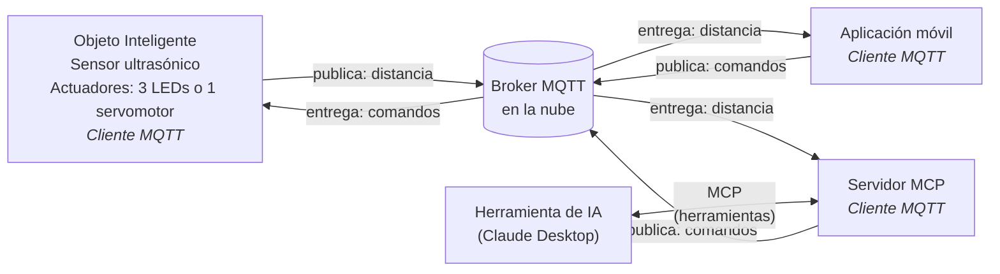

# Práctica MQTT — Integración de un Objeto Inteligente con MQTT y MCP

**Carrera:** Ingeniería de Sistemas
**Asignatura:** SIS-234
**Modalidad:** grupos de 2 o 3 integrantes
**Fecha límite de entrega:** jueves 29 de octubre de 2026, 17:45

---

## 1. Nombre de la Actividad Evaluativa

**Integración de un objeto inteligente con una aplicación móvil y una herramienta de IA con la ayuda de MQTT y MCP.**

---

## 2. Propósito de la Actividad Evaluativa

Evaluar el desarrollo de los siguientes saberes:

### 2.1 Saber Conceptual
- MQTT (Message Queuing Telemetry Transport): modelo publicación/suscripción, broker, tópicos y niveles de QoS.
- Herramientas de IA: agentes y MCP (Model Context Protocol).

### 2.2 Saber Procedimental
- Implementa protocolos de aplicación con integración en la nube: MQTT.
- Integra un objeto inteligente con una herramienta de IA mediante un servidor MCP.

### 2.3 Saber Actitudinal (Saber Ser)
- Disposición a realizar prácticas y ejercicios en equipo.
- Responsabilidad en sus asignaciones y prácticas.
- Orden, sistematicidad y disciplina durante el análisis, diseño y construcción del prototipo.

---

## 3. Descripción de la Actividad

Se deberá diseñar e implementar un sistema compuesto por:

- **1 Objeto Inteligente** con **sensor ultrasónico** y **actuadores** (mínimo **3 LEDs** o **1 servomotor**), con un MCU con conectividad WiFi.
- **1 aplicación móvil** que implemente el protocolo MQTT (p. ej. IoT MQTT Panel).
- **1 broker MQTT en la nube** de uso libre (p. ej. HiveMQ).
- **1 herramienta de IA** (p. ej. Claude Desktop) conectada al sistema mediante un **servidor MCP** desarrollado por el grupo.

> Todos los clientes se conectan al broker; ningún componente se comunica directamente con el objeto inteligente. El diagrama es referencial: cada grupo define sus propios tópicos, formato de mensajes y herramientas MCP.

### 3.1 Requerimientos Funcionales Mínimos

El sistema deberá cumplir, como mínimo, con los siguientes requerimientos:

**Objeto Inteligente**

- **RF1.** Medir la distancia entre el sensor ultrasónico y un objeto.
- **RF2.** Publicar periódicamente la distancia medida en un tópico del broker MQTT en la nube.
- **RF3.** Estar suscrito a un tópico de comandos y activar/desactivar sus actuadores según los comandos recibidos.

**Aplicación móvil**

- **RF4.** Desplegar la información del sensor de manera **gráfica, no textual** (p. ej. gráfico de línea, indicador tipo *gauge* o barra).
- **RF5.** Enviar comandos al objeto inteligente para activar/desactivar sus actuadores.

**Herramienta de IA**

- **RF6.** Interpretar instrucciones en **lenguaje natural** para mostrar los datos del sensor y para ejecutar comandos sobre los actuadores del objeto inteligente, a través de las herramientas expuestas por el servidor MCP.

Cada grupo deberá **definir y documentar sus propios tópicos, formato de mensajes y herramientas MCP** (ver §4.2). La tabla siguiente es únicamente un **ejemplo ilustrativo**.

**Ejemplo — tópicos y mensajes:**

| Tópico | Publica | Se suscribe | Ejemplo de mensaje |
|--------|---------|-------------|--------------------|
| `sis234/grupoN/distancia` | Objeto inteligente | Aplicación móvil, servidor MCP | `{"cm": 42.7}` |
| `sis234/grupoN/actuadores/cmd` | Aplicación móvil, servidor MCP | Objeto inteligente | `{"led": "rojo", "estado": "on"}` / `{"servo": 90}` |

> Nota: los nombres de tópicos y el formato de mensajes del ejemplo no son obligatorios; lo obligatorio son RF1 a RF6. Al usar un broker público, los tópicos deben incluir un **prefijo único del grupo** para no interferir con otros grupos.

**Ejemplos de instrucciones en lenguaje natural** que la herramienta de IA debe poder atender:

- _"¿A qué distancia está el objeto ahora?"_
- _"Enciende el LED rojo y apaga los demás."_
- _"Mueve el servomotor a 90 grados."_

### 3.2 Requerimientos No Funcionales

El sistema debe ser **estable y confiable**. Cada grupo deberá declarar en el README del repositorio (§4.2) y **verificar durante la Demo** al menos los siguientes atributos, con valores medibles:

- **Estabilidad:** operación continua durante un tiempo mínimo declarado (referencia: ≥ 10 minutos) sin reinicios ni bloqueos.
- **Exactitud de medición:** error máximo respecto a una referencia física, p. ej. una cinta métrica (referencia: ≤ ±3 cm dentro del rango de trabajo declarado).
- **Tiempo de respuesta:** el actuador debe reflejar un comando enviado desde la aplicación móvil en un tiempo máximo declarado, medido de extremo a extremo: aplicación → broker → objeto inteligente (referencia: ≤ 1 s).
- **Frecuencia de publicación:** número mínimo de lecturas publicadas por segundo declarado (referencia: ≥ 2 lecturas/s).
- **Reconexión:** el objeto inteligente debe restablecer automáticamente la conexión WiFi y MQTT tras una desconexión, sin intervención manual.

El código debe ser **legible, modular (orientado a objetos), documentado y conforme a las convenciones de codificación del lenguaje utilizado**.

Las **credenciales** (contraseña WiFi, usuario/contraseña del broker) **no deben publicarse** en el repositorio: se mantienen en un archivo de configuración excluido mediante `.gitignore`, acompañado de una plantilla de ejemplo sin valores reales.

---

## 4. Entregables

> En esta práctica **no se requiere Informe Técnico**. La evaluación se basa únicamente en la Demo y en la Defensa Individual (§5).

### 4.1 Prototipo Funcional
Se deberá presentar un prototipo completamente operativo que demuestre la integración entre el objeto inteligente, el broker MQTT en la nube, la aplicación móvil y la herramienta de IA.

### 4.2 Repositorio del Proyecto

El repositorio GitHub (ver §6) debe contener:

1. **Código fuente documentado** del objeto inteligente.
2. **Código fuente documentado** del servidor MCP.
3. **Configuraciones** utilizadas: plantilla de configuración del objeto inteligente (sin credenciales), configuración del servidor MCP en la herramienta de IA y, si la aplicación lo permite, exportación de la configuración del panel de la aplicación móvil.
4. Un **README** breve con:
   - Integrantes del grupo.
   - Tópicos MQTT y formato de los mensajes.
   - Herramientas MCP expuestas (nombre, parámetros y propósito).
   - Valores declarados de los requerimientos no funcionales (§3.2).
   - Instrucciones para ejecutar el sistema.

> El README no constituye un informe técnico ni se califica por separado; sirve de referencia para la Demo y la Defensa Individual.

---

## 5. Evaluación

### 5.1 Ponderación

| Componente | Peso |
|-------------|-------------|
| Demo | 1/2 |
| Defensa Individual | 1/2 |

- La **Demo** y la **Defensa Individual** se califican de forma **global, con un único nivel de 0 a 4**: nota del componente = `(nivel obtenido / 4) × 100`.

La nota final es el promedio de los dos componentes.

En ambos casos, el nivel **0 — No presentado** aplica cuando lo evaluado no se entrega, no se presenta o no puede evidenciarse.

---

### 5.2 Rúbrica de la Demo (1/2)

La demostración se califica de forma global con un único nivel de 0 a 4.

| Nivel | Descripción |
|----------|---------------|
| **4 - Excelente** | El sistema opera de forma completa y estable, con toda la comunicación pasando por el broker MQTT en la nube: el sensor se visualiza gráficamente en la aplicación, los actuadores responden a los comandos de la aplicación y de la herramienta de IA, y esta atiende correctamente las instrucciones en lenguaje natural solicitadas durante la demostración. Se verifican los requerimientos no funcionales declarados, incluida la reconexión. Montaje ordenado y seguro. |
| **3 - Satisfactorio** | El sistema cumple todos los requerimientos funcionales, con fallas menores que no impiden la demostración. |
| **2 - Satisfactorio con recomendaciones** | El sistema funciona parcialmente: algún componente (aplicación móvil, herramienta de IA o actuador) no responde como fue especificado. |
| **1 - Necesita mejorar** | Prototipo no funcional o con fallas críticas durante la demostración. |
| **0 - No presentado** | No se presentó el prototipo. |

---

### 5.3 Rúbrica de la Defensa Individual (1/2)

La defensa se califica de forma global con un único nivel de 0 a 4.

| Nivel | Descripción |
|----------|---------------|
| **4 - Excelente** | Responde con precisión y profundidad, explica cualquier parte del código, del circuito, de la configuración MQTT y del servidor MCP, y justifica técnicamente las decisiones tomadas. Su aporte al grupo es claro y verificable en el historial de commits del repositorio. |
| **3 - Satisfactorio** | Responde correctamente sobre el conjunto del trabajo, con dudas en aspectos puntuales. |
| **2 - Satisfactorio con recomendaciones** | Conoce solo la parte en la que trabajó directamente; explicaciones superficiales. |
| **1 - Necesita mejorar** | No logra explicar el funcionamiento del sistema ni justificar las decisiones de diseño. |
| **0 - No presentado** | No se presentó a la defensa. |

---

## 6. Entrega Final

**Qué se entrega:** un repositorio GitHub con el contenido descrito en §4.2.

Cada integrante debe realizar **commits con su propia cuenta de GitHub**; el historial de commits se utiliza como evidencia de su aporte en la Defensa Individual (§5.3).

**Cómo se entrega:** el **enlace del repositorio GitHub** se envía por el **LMS-UCB**.

**Cuándo:** hasta el **jueves 29 de octubre de 2026 a las 17:45**.

> El repositorio debe estar accesible para el docente en la fecha de entrega. Solo se evalúa el contenido existente en el repositorio hasta esa fecha; un enlace inaccesible equivale a trabajo no entregado. La entrega del enlace por el LMS es responsabilidad de cada grupo, y basta con que la realice un integrante.

---
